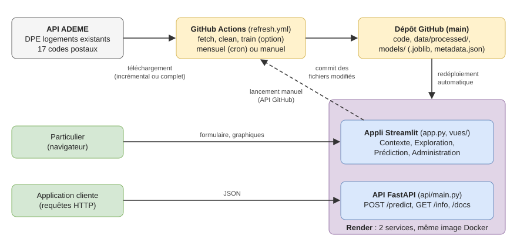
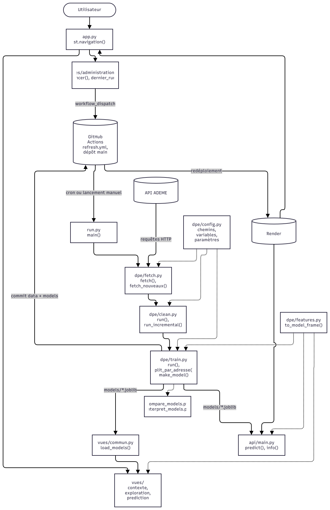

# Documentation technique - DPE Lyon

**Projet :** m2_enedis · **Équipe :** Xilian Jing, Quentin Bétemps, Soraya Saad

## 1. Architecture et responsabilités

L’application estime une classe DPE parmi A-B, C, D, E, F et G, ainsi qu’une consommation annuelle d’énergie finale en kWh/an. L’architecture sépare la préparation des données de leur exploitation : **GitHub Actions** exécute l’acquisition, le nettoyage et le réentraînement optionnel. **Render** exécute, à partir de la même image Docker, deux services : l’application Streamlit et l’API FastAPI. Le dépôt `main` contient les données nettoyées, les pipelines sérialisés et leurs métadonnées, utilisés lors du déploiement.



Le schéma est également fourni dans le fichier [architecture.drawio](architecture.drawio).
Un schéma d'architecture plus complet est également présent dans [architecture_detaillee.drawio](architecture_detaillee.drawio).

| Composant | Responsabilité |
|---|---|
| `app.py`, `vues/` | Navigation / pages Contexte, Exploration, Prédiction, Administration / ressources communes dans `vues/commun.py` |
| `api/main.py` | API FastAPI des modèles : `/predict`, `/info`, documentation `/docs` |
| `dpe/fetch.py`, `dpe/clean.py` | Acquisition ADEME / nettoyage / fusion des mises à jour |
| `dpe/features.py`, `dpe/config.py` | Transformations, types, chemins et configuration des modèles |
| `dpe/train.py`, `models/` | Entraînement et sauvegarde des pipelines `.joblib` et de `metadata.json` |
| `run.py`, `refresh.yml` | Orchestration locale et automatisation GitHub Actions |
| `compare_models.py`, `interpret_models.py` | Comparaison des candidats / matrice de confusion et importance des variables (`rapports/`) |

Les modèles utilisent 14 variables. Les transformations et l’estimateur sont conservés dans des pipelines scikit-learn. `to_model_frame()` harmonise les types entre apprentissage, application et API. Les informations manquantes sont prises en charge par le pipeline. Pour une maison, les types d’installation de chauffage et d’eau chaude sont transmis comme manquants, conformément aux données d’apprentissage.

<div style="page-break-before: always;"></div>

## 2. Installation et exécution

**Environnement de référence :** Python 3.12, versions fixées dans `requirements.txt` : Streamlit et Altair (interface), FastAPI et uvicorn (API), pandas et NumPy (données), scikit-learn et joblib (pipelines), requests (API ADEME et GitHub). matplotlib n’est requis que pour `interpret_models.py`.

```bash
docker build -t dpe-lyon .
docker run --rm -p 8501:8501 dpe-lyon                  # appli : http://localhost:8501
docker run --rm -p 8000:8000 dpe-lyon uvicorn api.main:app --host 0.0.0.0 --port 8000   # API : /docs
```

L’image (`python:3.12-slim`) lit le port dans `PORT`, 8501 par défaut, et charge données et modèles depuis le dépôt, sans acquisition ni entraînement. `.dockerignore` exclut notamment `.git`, `.venv` et les données brutes. Sans Docker, dans un environnement Python 3.12 : `pip install -r requirements.txt`, puis `streamlit run app.py` ou `uvicorn api.main:app`. `python run.py` reconstruit données et modèles (étapes `fetch`, `clean`, `train` et `--incremental` pour une mise à jour).

## 3. Actualisation et exploitation

Le workflow `.github/workflows/refresh.yml` réalise un incrémental le premier jour du mois à 03:00 UTC, sans réentraînement automatique. Un lancement manuel (onglet Actions ou page Administration) propose reconstruction complète et réentraînement. Les fichiers modifiés sont enregistrés sur `main`, ce qui déclenche le redéploiement Render. Sans changement, aucun commit n’est créé.

L’incrémental récupère les diagnostics à partir de `date_derniere_modification_dpe`, date de référence incluse. Une nouvelle version remplace l’ancienne grâce à `numero_dpe`. `numero_dpe_remplace` permet le retrait des diagnostics remplacés. Les suppressions ordinaires nécessitent une reconstruction complète.

L’entraînement complet atteint 675 Mo (mesure du 13 novembre), au-delà des 512 Mo de l’offre Render : il est donc séparé du serveur web. Sur Render, le service de l’appli utilise la commande du Dockerfile et la variable `GITHUB_TOKEN` (jeton limité au dépôt, droit Actions en lecture et écriture, jamais dans le code), `GITHUB_DEPOT`, `GITHUB_BRANCHE` et `URL_API` sont facultatives. Le service de l’API remplace la commande par `uvicorn api.main:app --host 0.0.0.0 --port $PORT`.

## 4. API des modèles

L’API (FastAPI, `api/main.py`) réutilise les pipelines et `to_model_frame()` de l’application : ses prédictions sont identiques. Elle est publique, sans authentification, `/docs` permet d’essayer chaque route depuis le navigateur.

| Route | Rôle |
|---|---|
| `POST /predict` | Entrée : modèle Pydantic généré depuis les 14 variables et les modalités de `metadata.json`, 3 champs obligatoires, autres à `null` par défaut. Sortie : `etiquette_dpe`, `conso_5_usages_ef`, `champs_non_renseignes`. Erreurs : 422 si saisie invalide ou champ inconnu, 503 si modèles absents |
| `GET /info` | Date d’entraînement, champs, valeurs acceptées, métriques |
| `GET /docs` | Documentation interactive / `GET /` y redirige |

## 4. Schéma d'architecture complet

