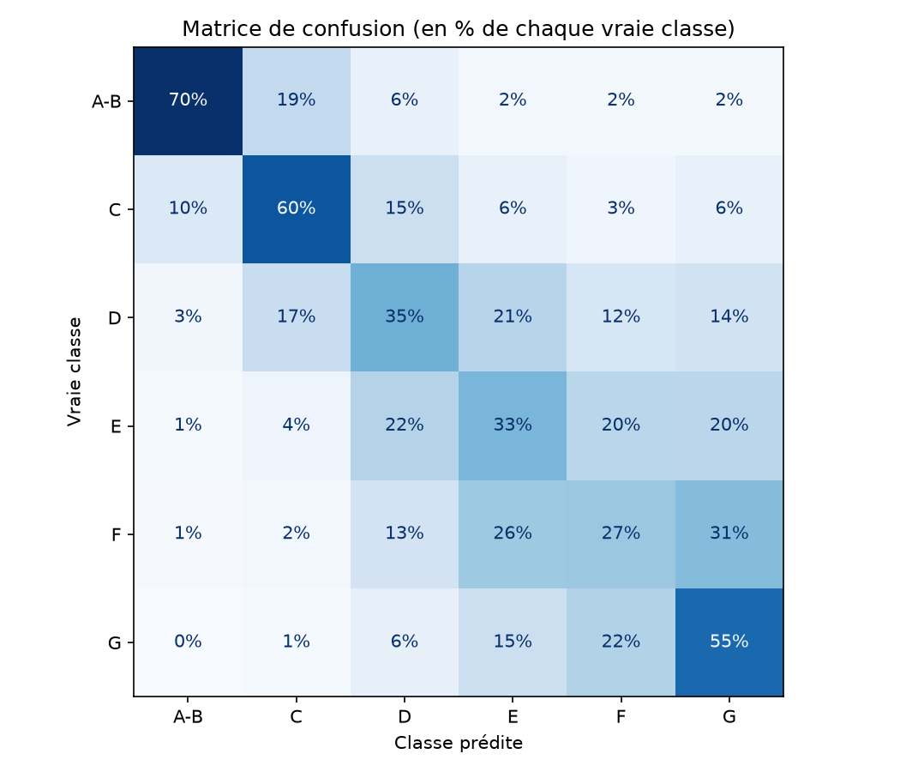
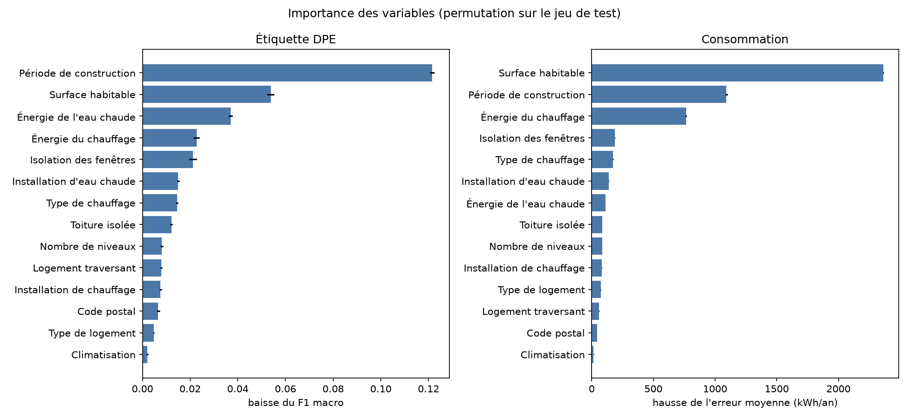

# Estimation du DPE et de la consommation énergétique des logements lyonnais

**Rapport de machine learning Master 2 SISE, Université Lumière Lyon 2**  
**Équipe :** Xilian Jing, Quentin Bétemps, Soraya Saad

## 1. Problématique et données

Le projet répond à un besoin fictif d’Enedis : estimer la performance énergétique d’un logement à partir d’informations renseignées par un particulier. Deux tâches supervisées sont traitées. La classification prédit le diagnostic de performance énergétique (DPE) en six classes ordonnées A-B, C, D, E, F et G, A et B étant fusionnées parce que A est rare. La régression prédit `conso_5_usages_ef`, consommation annuelle d’énergie finale des cinq usages, en kWh/an. La cible provient d’un diagnostic : elle ne constitue pas une mesure de facture réelle. *voir [1-3]*

Les données sont acquises par pagination de l’API ADEME des logements existants. La requête porte sur 17 codes postaux de Lyon et d’une partie de la métropole, les versions DPE ≥ 2,1 et les bâtiments autres que les immeubles entiers. Le nettoyage exclut aussi les appartements dont le DPE est généré à partir d’un DPE d’immeuble. Ce dernier filtre explique une partie importante de la réduction des effectifs, il ne s’agit pas simplement de supprimer des valeurs manquantes. *voir [1-3]*

| Fichier analysé | Effectif |
|---|---:|
| Lignes brutes, statistiques de la reconstruction | 307 949 |
| Diagnostics conservés, tous avec un numéro DPE distinct | 202 989 |
| Appartements / maisons | 194 570 / 8 419 |
| Adresses BAN distinctes | 32 951 |
| Lignes complètes sur les 14 entrées | 189 122 |

| Classe | A-B | C | D | E | F | G |
|---|---:|---:|---:|---:|---:|---:|
| Effectif du fichier nettoyé | 5 072 | 78 332 | 68 840 | 33 335 | 11 546 | 5 864 |

L’unité statistique est un diagnostic, pas nécessairement un logement unique. Les appartements représentent 95,9 % des enregistrements. Les classes C et D dominent, les performances globales doivent donc être complétées par des métriques par classe. Les premières expériences ne portaient que sur la première page de 10 000 lignes de l’API, qui n’était pas un échantillon aléatoire du périmètre.

Dans le nettoyage actuel, seules les lignes sans cible, code postal ou type de bâtiment sont supprimées pour manque d’information. Les champs d’installation de chauffage et d’eau chaude sont absents pour 100 % des maisons dans les statistiques du dépôt. Supprimer toute ligne incomplète aurait donc éliminé cette population. Les maisons sont désormais conservées. *voir [1, 3]*

## 2. Prétraitement et protocole d’évaluation

Les 14 entrées sont définies dans `dpe/config.py`. La ventilation des essais initiaux est retirée, la surface climatisée est transformée en indicateur de climatisation. Le générateur de chauffage principal est complété, si nécessaire, par celui de l’installation n°1, puis regroupé en **10 familles**, dont "Autre". *voir [3-5]*

| Traitement | Variables et règles |
|---|---|
| Sept variables nominales | Code postal, type de bâtiment, énergie et installation du chauffage, énergie et installation d’eau chaude, famille de générateur / `OneHotEncoder`, `drop="first"`, sortie dense |
| Deux variables ordinales | Période de construction / qualité d’isolation des menuiseries / ordre fixé dans la configuration |
| Deux variables numériques | Surface habitable et nombre de niveaux / médiane avec indicateur de manque lorsque celui-ci est appris / écrêtage 1 %-99 % en régression seulement |
| Trois variables binaires | Isolation de toiture, logement traversant, climatisation / valeurs manquantes codées -1 |

Les catégories nominales manquantes deviennent "inconnu" et les ordinales manquantes valent -1. L’encodeur rejette une modalité inconnue. `to_model_frame()` aligne colonnes et types pour l’entraînement, l’interface et l’API. La conversion de la climatisation remplace toutefois une surface manquante par zéro avant de tester si elle est positive : cette hypothèse de préparation n’est pas équivalente à conserver l’inconnu. *voir [3-5]*

Pour la régression, la **cible d’apprentissage** est également écrêtée aux quantiles 1 % et 99 %, soit **1 603,9 à 38 106,2 kWh/an** dans les métadonnées. Les cibles de validation et de test ne sont pas écrêtées. Ce choix réduit l’influence des extrêmes pendant l’ajustement, mais l’évaluation continue à compter leurs erreurs. La classification n’utilise pas cet écrêtage numérique. *voir [5, 7]*

### 2.1. Séparation par adresse

95,7 % des diagnostics partagent leur adresse avec d’autres, une même adresse peut donc correspondre à plusieurs logements et ne prouve pas un doublon exact. Le groupe est l’identifiant BAN, avec repli sur le numéro DPE si l’adresse manque. Le fichier décrit ici ne contient pas d’adresse manquante. `StratifiedGroupKFold`, trois plis, mélange activé et graine 42, fournit le premier pli comme test. Une assertion interdit une adresse commune aux deux ensembles. *voir [1, 3, 5]*

| Partition enregistrée, commune aux deux tâches | Diagnostics |
|---|---:|
| Apprentissage | 135 326 |
| Test | 67 663 |

Cette séparation évalue de nouvelles adresses du même périmètre. Elle ne démontre ni une généralisation à la France ni une performance sur des données futures. Le vocabulaire des catégories est construit sur tout le fichier avant séparation, et la sélection des modèles n’est pas imbriquée dans une évaluation externe indépendante. Ces limites sont discutées en section 6.

## 3. Comparaison et choix des modèles

`compare_models.py` compare sept classifieurs et six régresseurs avec le même prétraitement. Il vise par défaut environ 50 000 lignes en tirant des adresses entières. Le CSV ne consigne pas l’effectif exact ni la date de l’expérience. Chaque candidat utilise les mêmes trois plis, soit par adresse, soit aléatoires stratifiés sur la classe DPE. En régression, la cible est écrêtée dans chaque train, jamais dans la validation. Les résultats suivants sont des moyennes de validation croisée archivées, distinctes du test final. *voir [6]*

| Candidat | F1 adresse | F1 aléatoire | Accuracy adresse | Rappel G | Mo estimés |
|---|---:|---:|---:|---:|---:|
| RF leaf=1 | 0,364 | 0,415 | 0,475 | 0,196 | 140,7 |
| RF leaf=1 ms=0.3 | 0,357 | 0,389 | 0,452 | 0,309 | 61,4 |
| RF leaf=5 | 0,340 | 0,355 | 0,423 | 0,605 | 22,6 |
| RF leaf=20 | 0,321 | 0,328 | 0,402 | 0,689 | 8,4 |
| HGB lr=0.1 f=63 | 0,357 | 0,376 | 0,442 | 0,510 | 0,8 |
| HGB lr=0.05 f=127 | 0,362 | 0,382 | 0,449 | 0,463 | 2,3 |
| HGB lr=0.05 f=255 | 0,365 | 0,391 | 0,459 | 0,374 | 3,7 |

| Candidat | RMSE adresse | MAE adresse | R² adresse | Mo estimés |
|---|---:|---:|---:|---:|
| RF d=15, leaf=5 | 4155,3 | 2266,4 | 0,721 | 41,0 |
| RF leaf=1 | 4257,5 | 2358,6 | 0,707 | 247,3 |
| RF leaf=20 | 4202,4 | 2288,6 | 0,714 | 16,3 |
| HGB lr=0.1 f=63 | 4077,1 | 2209,0 | 0,731 | 0,3 |
| HGB lr=0.05 f=127 | 4097,3 | 2220,9 | 0,729 | 0,7 |
| HGB lr=0.05 f=255 | 4127,5 | 2242,4 | 0,725 | 1,2 |

RF désigne une forêt de 100 arbres, `leaf` est `min_samples_leaf`, `ms` est `max_samples`. Pour HGB, `lr` est le taux d’apprentissage et `f` le maximum de feuilles. RMSE et MAE sont en kWh/an. Les tailles sont celles du dernier modèle de pli, extrapolées linéairement pour RF. Pour HGB, le script réutilise la taille observée sans extrapolation. Ce sont des estimations, pas des mesures du modèle final.

HGB construit successivement des arbres pour améliorer l’ensemble, et les histogrammes discrétisent les valeurs numériques pour accélérer l’apprentissage. Le classifieur HGB à 255 feuilles obtient un F1 macro de 0,365, pratiquement égal au RF `leaf=1` (0,364), avec une accuracy inférieure mais un rappel G plus élevé et une taille estimée bien moindre. L’écart de F1 n’établit pas une supériorité statistique. Il s’entraîne aussi plus lentement dans cet export : 6,62 s contre 0,91 s par pli. Le choix est un compromis, non une domination sur tous les critères.

Le HGB à 63 feuilles est le meilleur régresseur de cette comparaison selon RMSE, MAE et R². Les paramètres finaux sont, pour la **classification**, `learning_rate=0.05`, `max_leaf_nodes=255`, `max_iter=500`, `class_weight="balanced"`, et pour la **régression** `learning_rate=0.1`, `max_leaf_nodes=63`, `max_iter=500`. Les deux activent `early_stopping=True` et utilisent la graine 42. *voir [4, 7]*

## 4. Résultats de classification et erreurs

Les résultats de `metadata.json` datent du 13 novembre. Leur cohérence a été contrôlée en recalculant les métriques à partir des effectifs de `matrice_confusion.csv`, sans réentraîner les modèles. Les quatre indicateurs coïncident : **accuracy 0,4503, accuracy à +/-1 classe 0,7877, F1 macro 0,3618, F1 pondéré 0,4802**. Une référence prédisant toujours C atteindrait 0,3859 d’accuracy et 0,0928 de F1 macro sur ce test. *voir [7, 8]*

L’accuracy est la proportion de catégories exactes, l’indicateur à +/-1 accepte un rang voisin dans A-B, C, D, E, F, G. La précision mesure la part correcte parmi les prédictions d’une classe, le rappel la part retrouvée parmi ses vrais membres. Le F1 est leur moyenne harmonique. Le F1 macro donne le même poids aux classes et le F1 pondéré utilise leurs effectifs.

| Classe | Effectif test | Précision | Rappel | F1 |
|---|---:|---:|---:|---:|
| A-B | 1690 | 25,9 % | 70,1 % | 0,378 |
| C | 26111 | 77,0 % | 59,8 % | 0,673 |
| D | 22946 | 52,7 % | 34,6 % | 0,418 |
| E | 11112 | 32,2 % | 32,7 % | 0,325 |
| F | 3849 | 14,1 % | 26,8 % | 0,185 |
| G | 1955 | 11,7 % | 54,8 % | 0,193 |

*Figure 1. Pourcentages par ligne, calculés sur les 67 663 diagnostics de test. La diagonale correspond au rappel. Source : `rapports/matrice_confusion.csv`.*

Le rappel G de 54,8 % s’accompagne d’une précision de 11,7 % : repérer une partie des G ne signifie pas que la majorité des prédictions G sont correctes. De même, la précision F n’est que de 14,1 %. Les erreurs D->E sont fréquentes (4 797), mais des confusions plus éloignées existent aussi, notamment D->G (3 128). Le score à +/-1 classe décrit une proximité ordinale, mais ne remplace pas l’accuracy exacte ni l’analyse des erreurs.

## 5. Régression et importance des variables

| Test final, cible annuelle non écrêtée | Résultat |
|---|---:|
| MAE | 2 189,80 kWh/an |
| RMSE | 4 019,57 kWh/an |
| R² | 0,7381 |

La MAE est l’écart absolu moyen. La RMSE est la racine de l’erreur quadratique moyenne et donne plus de poids aux grandes erreurs. Le R² compare l’erreur quadratique à celle d’une prédiction constante égale à la moyenne du test. La RMSE dépasse nettement la MAE, indiquant un poids important des grandes erreurs. Le fichier complet a une médiane de 7 054,7 kWh/an et un maximum de 277 134,8 kWh/an, statistiques qui décrivent le fichier, pas le seul test. L’écrêtage du train peut limiter l’ajustement des consommations extrêmes. Aucun intervalle de prédiction individuel n’est fourni. *voir [1, 5, 7]*

*Figure 2. Importance des variables d’origine, sur le test, avec cinq permutations par variable et graine 42. Les barres donnent la moyenne et les traits l’écart-type des cinq permutations. À gauche, baisse du F1 macro, à droite, hausse de la MAE en kWh/an. Source : `rapports/importance_variables.csv` et `interpret_models.py`.*

La permutation mélange une variable et mesure la dégradation du score, sans réentraîner le modèle. Pour la classification, la période de construction domine (**0,12150** de F1), suivie de la surface (**0,05377**) et de l’énergie de l’eau chaude (**0,03698**). Pour la régression, la surface arrive en premier (**+2 365,26 kWh/an de MAE**), devant la période (**+1 092,23**) et l’énergie du chauffage (**+765,09**). *voir [9]*

Ces résultats expriment une dépendance prédictive, pas un effet causal. Des variables corrélées peuvent se partager l’information, et une faible importance ne prouve pas une absence d’intérêt physique. Les écarts-types reflètent le hasard des permutations sur ce test fixe, et non l’incertitude entre populations. Les deux panneaux ont des unités différentes et ne sont pas directement comparables.

## 6. Discussion, reproductibilité et conclusion

**Portée de l’évaluation.** Le modèle améliore la référence majoritaire mais ne prédit exactement que 45,0 % des classes. Le déséquilibre, la forte majorité d’appartements et les omissions du formulaire limitent l’interprétation globale. Les scores sont calculés avec les informations disponibles dans les diagnostics, sans mesurer séparément le cas où seuls les trois champs obligatoires sont fournis. Une évaluation par type de logement et par niveau d’information serait utile.

**Indépendance des étapes.** `categories_from()` utilise toutes les lignes, y compris celles du test, pour définir les modalités. Cela ne transmet pas directement les cibles au modèle, mais rend le prétraitement partiellement transductif. Le comparateur échantillonne le fichier complet avant la séparation finale : les adresses utilisées pour choisir les hyperparamètres peuvent donc recouper le test final. Un protocole confirmatoire devrait réserver ce test avant toute sélection et apprendre les catégories dans chaque train, avec une stratégie explicite pour les modalités nouvelles.

**Validation interne.** L’arrêt anticipé HGB n’est pas configuré pour grouper par adresse, sa validation interne peut mélanger des adresses. Le test externe demeure séparé par adresse, mais le choix du nombre d’itérations n’est pas entièrement groupé. Le CSV de comparaison ne contient pas de dispersion entre plis. Les petits écarts observés ne permettent donc pas, seuls, de conclure à une différence statistiquement établie.

**Traçabilité et exploitation.** Les modèles et prétraitements sont sérialisés ensemble, et l’application Streamlit et l’API FastAPI réutilisent `to_model_frame()`. La version de référence est scikit-learn 1.9.1. Les fichiers courants pèsent 5,32 Mo pour la classification et 0,66 Mo pour la régression. GitHub Actions actualise les données chaque mois sans réentraînement par défaut, si bien que données et modèles peuvent donc avoir des dates différentes. Une réévaluation doit conserver versions, ordre des lignes et partition, plutôt que supposer qu’une même graine suffit dans tout environnement. *voir [4, 5, 7, 10]*

Le HGB constitue ainsi un compromis déployable entre précision, détection des classes rares et taille. Il convient à une estimation exploratoire dans le périmètre lyonnais, mais ses résultats ne justifient ni un remplacement du diagnostic réglementaire ni une extrapolation nationale sans nouvelle validation.

### Sources du dépôt

1. [Statistiques de nettoyage](https://github.com/Nylphis/m2_enedis/blob/aabe5d2f4de223ce2c43639692e39500de5b041e/data/processed/clean_stats.json) et [données nettoyées](https://github.com/Nylphis/m2_enedis/blob/aabe5d2f4de223ce2c43639692e39500de5b041e/data/processed/dpe_clean.csv).
2. [Acquisition ADEME](https://github.com/Nylphis/m2_enedis/blob/aabe5d2f4de223ce2c43639692e39500de5b041e/dpe/fetch.py).
3. [Nettoyage](https://github.com/Nylphis/m2_enedis/blob/aabe5d2f4de223ce2c43639692e39500de5b041e/dpe/clean.py).
4. [Configuration](https://github.com/Nylphis/m2_enedis/blob/aabe5d2f4de223ce2c43639692e39500de5b041e/dpe/config.py) et [transformations](https://github.com/Nylphis/m2_enedis/blob/aabe5d2f4de223ce2c43639692e39500de5b041e/dpe/features.py).
5. [Entraînement et évaluation](https://github.com/Nylphis/m2_enedis/blob/aabe5d2f4de223ce2c43639692e39500de5b041e/dpe/train.py).
6. [Comparateur](https://github.com/Nylphis/m2_enedis/blob/aabe5d2f4de223ce2c43639692e39500de5b041e/compare_models.py) et [résultats CSV](https://github.com/Nylphis/m2_enedis/blob/aabe5d2f4de223ce2c43639692e39500de5b041e/reports/comparaison_modeles.csv).
7. [Métadonnées des modèles](https://github.com/Nylphis/m2_enedis/blob/aabe5d2f4de223ce2c43639692e39500de5b041e/models/metadata.json).
8. [Matrice de confusion](https://github.com/Nylphis/m2_enedis/blob/aabe5d2f4de223ce2c43639692e39500de5b041e/reports/matrice_confusion.csv).
9. [Script d’interprétation](https://github.com/Nylphis/m2_enedis/blob/aabe5d2f4de223ce2c43639692e39500de5b041e/interpret_models.py) et [importances CSV](https://github.com/Nylphis/m2_enedis/blob/aabe5d2f4de223ce2c43639692e39500de5b041e/reports/importance_variables.csv).
10. [API](https://github.com/Nylphis/m2_enedis/blob/aabe5d2f4de223ce2c43639692e39500de5b041e/api/main.py) et [workflow de mise à jour](https://github.com/Nylphis/m2_enedis/blob/aabe5d2f4de223ce2c43639692e39500de5b041e/.github/workflows/refresh.yml).
